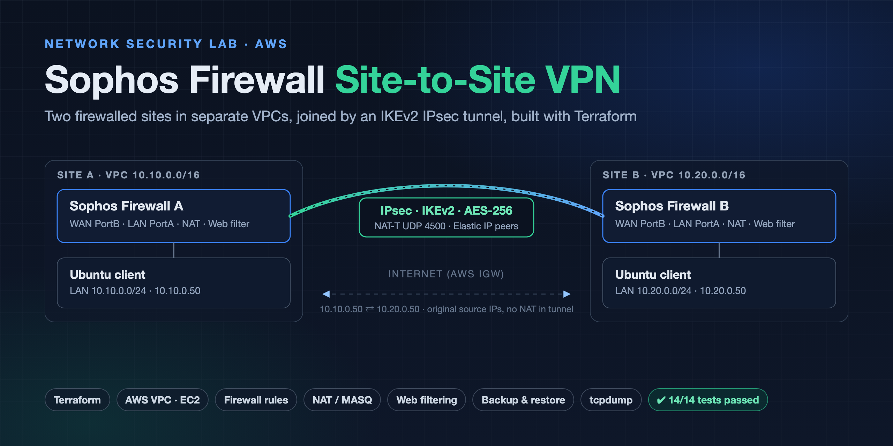

# Sophos Firewall Site-to-Site VPN Lab (AWS)



▶ **[Watch the 1-minute walkthrough](docs/sophos-s2s-vpn-demo.mp4)**, also on my [portfolio](https://jeevanandh32.github.io/#vpn).

Two Sophos Firewall (SFOS v22) appliances in separate AWS VPCs, each protecting an Ubuntu client. They're connected by an IKEv2 IPsec site-to-site tunnel, and the whole lab is deployed with Terraform.

## Topology

```
            Internet (AWS IGW)                         Internet (AWS IGW)
                   |                                          |
        EIP  ┌─────┴──────┐   IPsec IKEv2 / NAT-T     ┌──────┴─────┐  EIP
             │ Sophos FW A │<========================>│ Sophos FW B │
             │ PortB  WAN  │      UDP 500/4500        │ PortB  WAN  │
             │ PortA  LAN  │                          │ PortA  LAN  │
             └─────┬──────┘                           └──────┬─────┘
          10.10.0.0/24 (LAN)                         10.20.0.0/24 (LAN)
                   |                                          |
           client-site-a 10.10.0.50                  client-site-b 10.20.0.50
      VPC 10.10.0.0/16 (Site A)                    VPC 10.20.0.0/16 (Site B)
```

- **Firewalls:** each one is deployed with Sophos's official standalone PAYG CloudFormation template, called from Terraform.
- **Routing:** each LAN subnet's default route points at its firewall's LAN interface, so all client traffic is inspected.
- **Admin access:** WebAdmin and SSH are open only to a single admin /32.
- **IPsec ports:** UDP 500, UDP 4500 and ESP are open only between the two firewalls' public IPs.
- **Client access:** clients have no public IPs and are reached through EC2 Instance Connect Endpoints.

## What's configured

| Area | Configuration |
|------|---------------|
| Zones | PortA = LAN, PortB = WAN |
| NAT | LAN to WAN masquerade (default SNAT); no NAT across the tunnel |
| Firewall rules | ICMP to the internet denied and logged (placed above the allow rule); LAN to WAN allowed |
| Web filtering | Web policy blocks the *Social networking* category |
| Site-to-site VPN | IKEv2, PSK, 10.10.0.0/24 ↔ 10.20.0.0/24; Site A initiates, Site B responds; Local and Remote IDs set to the Elastic IPs because of AWS 1:1 NAT |
| Backup/restore | Local config backup, a rule change, a restore, and a check that the change was reverted |

## Validation

[`scripts/client-tests.sh`](scripts/client-tests.sh) runs on each client and reports PASS/FAIL for each check:
- HTTPS and DNS work through NAT, and the source IP the internet sees is the firewall's Elastic IP
- Ping to the internet is blocked and shows up in the firewall log
- The blocked category fails while an allowed site works
- The other site's client is reachable over IPsec by private IP (ICMP and TCP/22)

The evidence is `tcpdump` on the clients, Sophos packet capture, and the log viewer. Results and screenshots are in [`docs/`](docs/).

## Usage

```bash
cd terraform
echo 'admin_cidr = "<your-public-ip>/32"' > terraform.tfvars
terraform init && terraform apply
terraform output firewalls
```

Then follow the [build guide](docs/Sophos-S2S-VPN-Lab-Guide.pdf) for the firewall, VPN, testing and backup steps. Run `terraform destroy` when you're done.

Prerequisite: a subscription to the Sophos Firewall Standalone PAYG AWS Marketplace listing.
